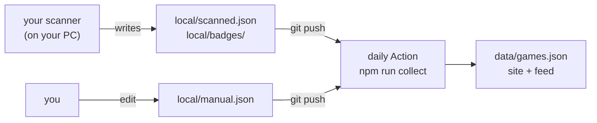

[← README](../README.md) · [Configuration](configuration.md) · [The feed](feed.md) · **Local games** · [Development](development.md)

# Local games

Steam and RetroAchievements have web APIs, so the daily Action can ask them what
you played. An emulator, a standalone launcher, or a console you track by hand
has none — and the Action runs on GitHub, so it cannot look at your PC either.

Local games close that gap with two JSON files you commit. The collector reads
them on every run and publishes their games alongside the rest, with cover art
from SteamGridDB, as the source `local`.

The template ships the format and the collector's half. The half that reads a
particular emulator's files is yours to write, because every emulator keeps
different records in a different place — or skip it and write the file by hand.



## The files

Both are optional. Neither is under `data/`, so neither is published — they are
inputs to the feed, not part of it.

| File                 | Written by                  | What it is                                                     |
| -------------------- | --------------------------- | -------------------------------------------------------------- |
| `local/scanned.json` | A script you run on your PC | Everything the script found. Replaced on every scan.           |
| `local/manual.json`  | You, by hand                | Corrections to scanned games, and games no script can see.     |
| `local/badges/`      | Your script, by convention  | Achievement badge images, when the game's own files have them. |

## The shape

Both files hold `{ "games": [ … ] }`. The authoritative definition is
`LocalGame` in [collector/sources/local.ts](../collector/sources/local.ts),
which a TypeScript scanner can import directly.

```json
{
  "games": [
    {
      "id": "myemu-0100abcd",
      "title": "Some Game",
      "platform": "Nintendo Switch",
      "lastPlayedAt": "2026-11-20T21:04:00Z",
      "playtimeMinutes": 512,
      "achievements": {
        "earned": 12,
        "total": 40,
        "recent": [
          {
            "id": "first-boss",
            "title": "First Boss",
            "description": "Defeat the first boss",
            "earnedAt": "2026-11-20T20:51:13Z",
            "badge": "local/badges/myemu-0100abcd/first-boss.png"
          }
        ]
      }
    }
  ]
}
```

### A game

| Field             | Required | Meaning                                                                                                                  |
| ----------------- | -------- | ------------------------------------------------------------------------------------------------------------------------ |
| `id`              | yes      | Stable and unique. Published as `local-<id>`, so never change it once a game is live. Prefix it with where it came from. |
| `title`           | yes      | The game's name.                                                                                                         |
| `platform`        | yes      | What the site shows where a service name would go — `"Nintendo Switch 2"`, `"PC"`. Also feeds the platform filter.       |
| `lastPlayedAt`    | yes      | ISO-8601. Decides its place in the newest-first feed.                                                                    |
| `playtimeMinutes` | no       | Counted in time played and the most-played chart, like Steam's.                                                          |
| `achievements`    | no       | Omit for a game with no achievement system. See below.                                                                   |
| `coverSearch`     | no       | What to search SteamGridDB for, when the title matches badly. Defaults to `title`.                                       |
| `steamGridDbId`   | no       | Pins the cover to one SteamGridDB game. See [Cover art](#cover-art).                                                     |
| `coverImage`      | no       | A direct link to the exact poster to use. See [Cover art](#cover-art).                                                   |

### Achievements

| Field    | Meaning                                                                                      |
| -------- | -------------------------------------------------------------------------------------------- |
| `earned` | How many are earned.                                                                         |
| `total`  | How many the game defines; `0` when that is not known, which leaves completion unshown.      |
| `recent` | The newest earned, newest first. Only `achievementsPerGame` (see `site.config.ts`) are kept. |

Each entry in `recent` has an `id` (unique within the game), `title`,
`description`, `earnedAt` (ISO-8601), and optionally `badge`.

## Correcting and adding by hand

Each entry in `local/manual.json` is matched to a scanned game by `id`, and the
fields it sets win. So an entry needs only what it changes:

```json
{
  "games": [
    { "id": "myemu-0100abcd", "title": "Some Game: Definitive Edition" },
    { "id": "myemu-0100beef", "hidden": true },
    {
      "id": "switch-links-awakening",
      "title": "The Legend of Zelda: Link's Awakening",
      "platform": "Nintendo Switch",
      "lastPlayedAt": "2026-10-02T19:00:00Z"
    }
  ]
}
```

- **Override:** any field, on any scanned game.
- **Hide:** `"hidden": true` drops a scanned game without touching the scanner.
- **Add:** an entry whose `id` matches nothing scanned is a game of its own, and
  needs `title`, `platform` and `lastPlayedAt`. One missing any of those is
  skipped with a warning in the collect log rather than failing the run.

With no scanner at all, `manual.json` alone is a complete, hand-kept list.

## Cover art

By default a game's cover is the first suitable 600×900 poster from a
SteamGridDB search for its title. That needs `STEAM_GRID_DB_API_KEY`, the same
as emulated RetroAchievements games. When the search goes wrong:

| Problem                                              | Fix                                                                                   |
| ---------------------------------------------------- | ------------------------------------------------------------------------------------- |
| The title has noise in it — `"Some Game (64-bit)"`   | `coverSearch: "Some Game"`                                                            |
| Two games share the name — a remake and its original | `steamGridDbId`: the number in the right game's `steamgriddb.com/game/<id>` URL       |
| Right game, wrong poster                             | `coverImage`: the download link of the poster you want, from its steamgriddb.com page |

`coverImage` wins over `steamGridDbId`, which wins over `coverSearch`.

The art library never replaces a file it holds, so a cover the search already
fetched would otherwise stay. A pinned or chosen cover is therefore stored under
a name of its own, and takes over on the next collect.

## Badges

A badge is a file, not a URL: `badge` is a path from the repository root to an
image you commit, by convention under `local/badges/<game id>/`. The collector
copies it into the art library at
`images/badges/local/<game id>/<achievement id>` — the same permanent,
never-overwritten library every other badge lives in.

It is a file because a local game's badges usually come out of the game's own
data, which only your PC can read. The site upscales small images — a 16×16
texture, say — with hard pixel edges rather than blurring them.

Only badges for the achievements currently in `recent` need to be in
`local/badges/`. Once collected, the library keeps its own copy, so a scanner
can delete badges that have dropped out of `recent`.

## Writing a scanner

A scanner is any program that writes `local/scanned.json` in the shape above.
Put a TypeScript one under `collector/scanners/` and `npm run typecheck`
covers it, and it can import the types:

```ts
// collector/scanners/my-launcher.ts — run with: npx tsx collector/scanners/my-launcher.ts
import { readFile, writeFile } from "node:fs/promises";
import type { LocalGame, ScannedFile } from "../sources/local";

// Wherever your launcher keeps its records, in whatever shape it uses.
const history = JSON.parse(await readFile("C:/Games/MyLauncher/history.json", "utf8")) as {
  name: string;
  lastRun: number;
  seconds: number;
}[];

const games: LocalGame[] = history.map((entry) => ({
  id: `mylauncher-${entry.name.toLowerCase().replace(/[^a-z0-9]+/g, "-")}`,
  title: entry.name,
  platform: "PC",
  lastPlayedAt: new Date(entry.lastRun * 1000).toISOString(),
  playtimeMinutes: Math.round(entry.seconds / 60),
}));

// Stable order, and no write when nothing changed: a scan that finds nothing
// new then leaves git with nothing to commit.
const scanned: ScannedFile = { games: games.sort((a, b) => a.id.localeCompare(b.id)) };
const text = `${JSON.stringify(scanned, null, 2)}\n`;
if (text !== (await readFile("local/scanned.json", "utf8").catch(() => ""))) {
  await writeFile("local/scanned.json", text);
}
```

Things worth getting right:

- **One file, one writer.** With several emulators, have one entry script run
  each scanner and write `scanned.json` once — two scripts writing the same
  file would each erase the other's games.
- **Your repository is probably public.** Write what the feed needs and nothing
  else: no install paths, save names, usernames, or account ids.
- **Stable ids.** Base them on something the emulator keeps fixed, like a title
  id, not on a name you might correct later.
- **State of your own** — names learned from a log that gets rotated, say — can
  live in `scanned.json` under any other top-level key. The collector ignores
  it, and `readScanned<{ yourKey: … }>()` reads it back.
- **Never write `manual.json`.** It is yours, and it overrides the scan, which
  is what makes it safe to fix things there.

## Publishing

A scan only changes files on your PC. To publish, commit them and push:

```bash
git pull --rebase                          # the daily run commits to main too
git add local/scanned.json local/badges
git commit -m "data: local snapshot"
git push
```

The next daily run publishes them; **Run workflow** on the _Collect and publish_
Action does it immediately. To scan automatically, schedule the script plus
those git commands with Windows Task Scheduler, `cron`, or `launchd`.

To preview first, run your scanner, then `npm run collect` (which needs your API
credentials) and `npm run dev`. That collect rewrites `data/` and `images/`,
which the daily run also commits — so discard those changes before you next pull
(`git restore data images` and `git clean -fd data images`) rather than
committing them, or the pull will conflict.

## On the site

- Local games are the `local` source, labelled **Other**. The Library page's
  Other tab appears only once there are some.
- The platform you give is what cards show, and it joins the platform filter.
- Playtime and achievements count towards the overview's totals like any other
  source's.

Local games never publish on their own. If every API source fails, the run
still writes nothing — otherwise a library of only your local games would
replace your real one.
